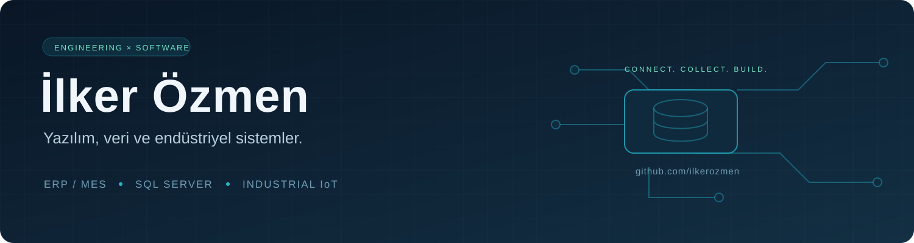

# Merhaba, ben İlker 👋

**Sistem Geliştirme Kıdemli Uzmanı · Mekatronik Yüksek Mühendisi**

Üretim sahasından veritabanına, veriden iş süreçlerine.

---

### 👨‍💻 Hakkımda

Mekatronik Yüksek Mühendisliği altyapımı yazılım geliştirme, ilişkisel veritabanları ve endüstriyel otomasyon deneyimimle birleştiriyorum. ERP ve MES sistemleri, web servisleri ve API'ler, raporlama ve sahadan veri toplama projelerinde çalıştım.

- 🏭 **Aster Textile'da Sistem Geliştirme Kıdemli Uzmanı** olarak yazılım geliştirme, raporlama, süreç yönetimi ve ERP/MES çalışmalarında görev alıyorum.
- 🗄️ **SQL Server ve T-SQL** ile veritabanı yapıları, view'lar, saklı prosedürler ve raporlar üzerinde çalışıyorum.
- 📡 **IoT ve gömülü sistemler** tarafında cihazlardan veri toplama, kablosuz veri aktarımı ve ERP entegrasyonu deneyimine sahibim.
- 🎓 **Akıllı Ulaşım Sistemleri yüksek lisans mezunuyum.** Akademik çalışmalarımda bulanık mantık ve sürücü destek sistemleri üzerine çalıştım.
- 🌱 Üretimde dijitalleşme, enerji verimliliği, karbon ayak izi, veri bilimi ve simülasyon ilgi alanlarım arasında.

### 🛠️ Teknolojiler & Çalışma Alanları

| 💻 Yazılım & Veri | 🏭 Kurumsal Sistemler | 📡 IoT & Gömülü Sistemler |
| :--- | :--- | :--- |
|    |    |   |
|   |   |   |
|   |  |   |

### 🔎 Odak Noktalarım

**Kurumsal yazılım & entegrasyon**  
ERP/MES süreçlerinin iyileştirilmesi, web servisleri ve API'ler üzerinden sistemlerin birlikte çalışması, ihtiyaç analizi ve kullanıcı eğitimleri.

**Veritabanı & raporlama**  
İlişkisel veritabanı mimarileri, SQL Server yönetimi, T-SQL geliştirmeleri ve iş süreçlerini destekleyen raporlama çözümleri.

**Endüstriyel IoT & otomasyon**  
Üretim makinelerinden veri toplama, gömülü sistem yazılımları ve sahadaki verilerin kurumsal sistemlere aktarılması.

### 💼 Deneyimden Kısa Notlar

| Dönem | Kurum | Görev |
| :--- | :--- | :--- |
| Temmuz 2025 - Devam ediyor | **Aster Textile** | Sistem Geliştirme Kıdemli Uzmanı |
| Temmuz 2024 - Temmuz 2025 | **ETKA-D Mould & Plastic** | ERP Sistem Yöneticisi |
| Kasım 2019 - Ocak 2023 | **Güncel Yazılım** | ERP Proje Mühendisi (Otomasyon) |

<b>🎓 Eğitim & Akademik Çalışmalar</b>

#### Eğitim

- **Bandırma Onyedi Eylül Üniversitesi** — Akıllı Ulaşım Sistemleri, Yüksek Lisans (2020-2022)
- **Gaziosmanpaşa Üniversitesi** — Mekatronik Mühendisliği, Lisans (2013-2018)

#### Yayınlar

- Analysis of Vehicle Driving Assistant System Model with Sugeno Fuzzy
- Design of Fuzzy Logic Supported Car Driver Control System
- Sürücü Etkileşimli Taşıt Sürüş ve Eğitim Sisteminin Tasarımı

---

**Yazılım · Veri · Endüstriyel Sistemler**

[Projelerimi keşfedin →](https://github.com/ilkerozmen?tab=repositories)

